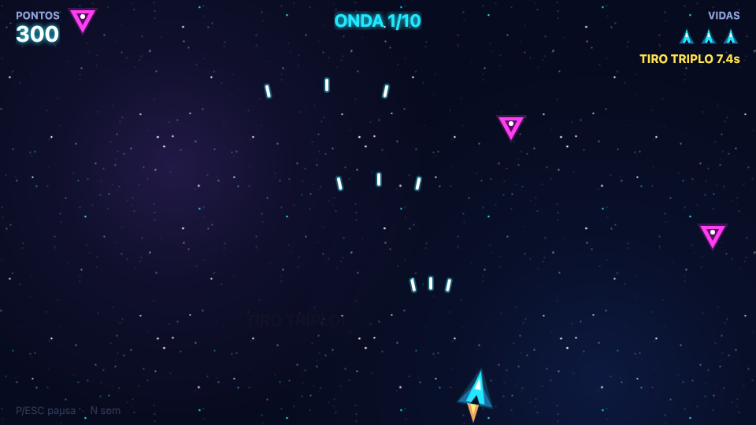
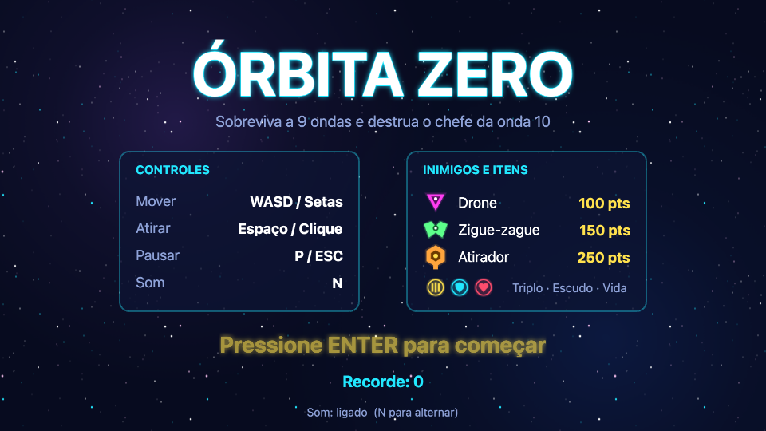
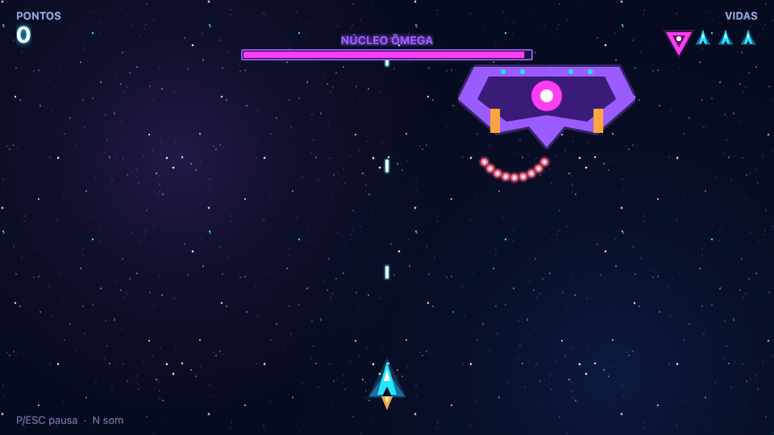
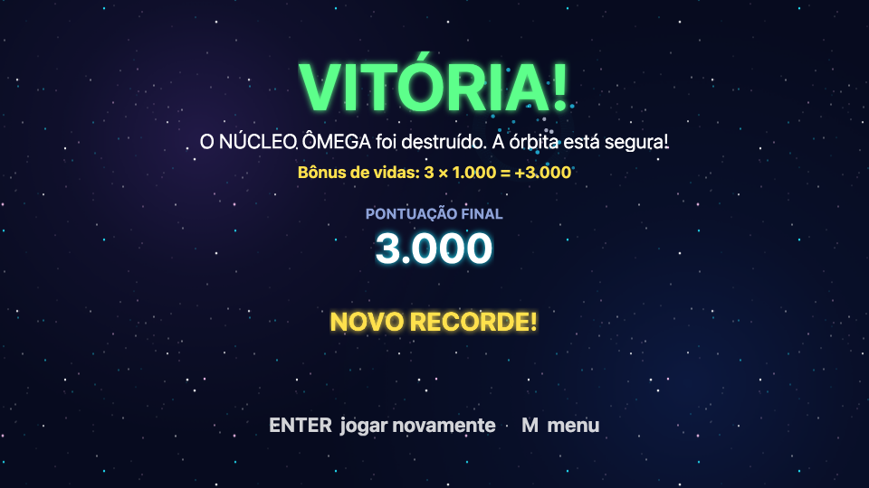
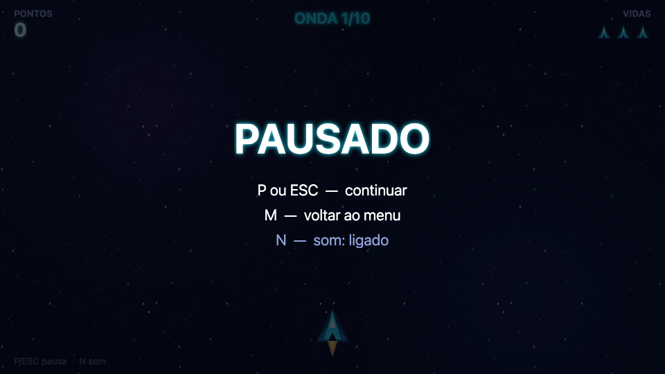

# Órbita Zero

Shooter espacial de sobrevivência feito com **Phaser 3** para a disciplina de **Desenvolvimento de Jogos Digitais**.
Pilote a nave, sobreviva a **9 ondas** de inimigos cada vez mais rápidos e destrua o chefe **Núcleo Ômega** na **onda 10**.



**▶ Jogar online:** https://serafim0505.github.io/orbita-zero/

| Menu | Chefe | Vitória |
| :---: | :---: | :---: |
|  |  |  |
| **Pausa** | **Fim de jogo** | |
|  |  | |

## Controles

| Ação | Teclas |
| --- | --- |
| Mover a nave | **WASD** ou **setas** |
| Atirar (segurar) | **Espaço** ou **botão esquerdo do mouse** |
| Pausar / continuar | **P** ou **ESC** |
| Ligar/desligar som | **N** |
| Começar / jogar de novo | **ENTER** (no menu também vale clique) |
| Voltar ao menu | **M** (na pausa e nas telas finais) |

## Como jogar

- Você tem **3 vidas**. Ao levar dano, a nave pisca e fica **invencível por 1,5 s**.
- Cada inimigo vale pontos diferentes: **Drone 100**, **Zigue-zague 150**, **Atirador 250**, asteroide 50.
- **Combo:** a cada 5 abates seguidos sem levar dano o multiplicador sobe (até **x5**). Levar dano zera o combo.
- Inimigos destruídos têm ~12% de chance de soltar um **power-up**:
  **tiro triplo** (8 s), **escudo** (absorve 1 acerto) ou **vida extra** (máx. 5).
- **Asteroides** (a partir da onda 2) giram, cruzam a tela na diagonal e aguentam 2 tiros.
- **Vitória:** derrotar o chefe da onda 10 (bônus de 1.000 pontos por vida restante).
  **Derrota:** perder todas as vidas. O **recorde** fica salvo no navegador.

## Como rodar localmente

Pré-requisito: [Node.js](https://nodejs.org/) 20.19 ou mais recente.

```bash
npm install
npm run dev
```

Abra o endereço que aparecer no terminal (normalmente http://localhost:5173).

Outros comandos:

```bash
npm run build      # gera a versão final em dist/
npm run preview    # serve o build em http://localhost:4173/orbita-zero/
npm test           # teste automatizado (Playwright) — na 1ª vez rode: npx playwright install chromium
```

## Tecnologias

- **Phaser 3.90** (engine 2D) com **física Arcade**
- **Vite** (servidor de desenvolvimento e build)
- **JavaScript puro** (módulos ES), sem TypeScript
- **Web Audio API** para todos os sons (sintetizados em código)
- **Playwright** para o teste automatizado
- **GitHub Actions + GitHub Pages** para publicar o jogo

Não há **nenhum arquivo de imagem ou áudio externo**: todos os gráficos são desenhados com `Phaser.Graphics` e
convertidos em texturas (`generateTexture`) na `BootScene`, e todos os sons são gerados com osciladores e ruído
no `AudioManager`.

## Requisitos do trabalho → onde foram implementados

No código, cada ponto está marcado com um comentário padrão, por exemplo `// [CONCEITO 4 - COLISÕES]`
(dá para achar todos com uma busca por `[CONCEITO`).

| Requisito | Onde foi implementado | Explicação curta |
| --- | --- | --- |
| **1. Controle de entradas (teclado/mouse)** | `src/scenes/GameScene.js` (`createInput`, `readDirection`, `isFiring`), `src/scenes/MenuScene.js`, `src/scenes/PauseScene.js` | Setas/WASD movem, Espaço ou clique atiram, P/ESC pausam, N liga/desliga som, ENTER/M navegam entre telas. |
| **2. Movimentação de personagens/objetos** | `src/entities/Player.js` (`move`), `DroneEnemy.js`, `ZigZagEnemy.js`, `ShooterEnemy.js`, `Asteroid.js`, `Boss.js` | Cada objeto tem seu jeito de se mover: reta, seno, parar e deslizar, diagonal girando, flutuar de lado a lado. |
| **3. Transform e/ou física** | `src/entities/Player.js` (aceleração + drag + velocidade máxima), `ZigZagEnemy.js` (física no Y, Transform no X), `Asteroid.js` (velocidade angular), `Bullet.js` | A nave não "teleporta": a tecla aplica **aceleração**, a física calcula velocidade/posição e o **drag** freia. |
| **4. Colisões e interações** | `src/scenes/GameScene.js` (`createCollisions`, `onBulletHitEnemy`, `onPlayerHitByBullet`, `onCollectPowerUp`, `startBoss`) | `physics.add.overlap` entre grupos: tiro × inimigo, tiro × asteroide, tiro × chefe, nave × inimigo/tiro/item. Hitboxes circulares menores que o desenho. |
| **5. Pontuação, vidas, vitória/derrota** | `src/systems/ScoreManager.js`, `GameScene.js` (`damagePlayer`, `killPlayer`, `onBossDefeated`, `endGame`), `GameOverScene.js`, `VictoryScene.js` | Pontos por tipo × combo, 3 vidas com invencibilidade, vitória ao matar o chefe, derrota com 0 vidas, recorde em `localStorage`. |
| **6. Estados/comportamentos** | `src/config.js` (`GAME_STATES`), `GameScene.js` (`setGameState`), `WaveManager.js`, `Player.js` (`PLAYER_STATES`), `ShooterEnemy.js`, `Boss.js` (`BOSS_STATES`), `src/main.js` (cenas) | Máquinas de estado em 3 níveis: **cenas** (Menu → Jogo → Pausa → Fim), **partida** (`WAVE_TRANSITION`, `PLAYING`, `BOSS`, `DEAD`, `VICTORY`) e **entidades** (nave invulnerável, atirador entrando/atacando/saindo, chefe com padrões). |
| **7. Interface e feedback** | `src/scenes/UIScene.js` (HUD), `src/systems/Effects.js`, `src/systems/AudioManager.js`, `src/systems/Starfield.js` | HUD com pontos, vidas, onda, combo, power-ups e barra do chefe; avisos "ONDA X"/"ALERTA!"; partículas, texto flutuante, flash branco, tremor de tela, sons e fundo em parallax. |

## Estrutura do projeto

```
src/
├── main.js            # configuração do Phaser, lista de cenas, gancho de debug
├── config.js          # TODAS as constantes ajustáveis (velocidades, vidas, pontos, chances...)
├── scenes/            # Boot, Menu, Game, UI (HUD), Pause, GameOver, Victory (+ ResultScene base)
├── entities/          # Player, Bullet, Enemy (+ Drone, ZigZag, Shooter), Boss, Asteroid, PowerUp
├── systems/           # WaveManager, ScoreManager, AudioManager, Effects, Starfield
└── ui/styles.js       # estilos de texto
tests/smoke.spec.js    # teste automatizado do fluxo completo
docs/EXPLICACAO.md     # guia de estudo para a apresentação
```

## Testes

`npm test` sobe o build, abre o jogo no Chromium e verifica: zero erros no console; menu → jogo com ENTER;
pausa e retomada; ~20 s de jogo simulado (movimento + tiros, com pontuação > 0); game over; jogar de novo
(pontuação e vidas reiniciadas); chefe; vitória; volta ao menu. Os screenshots deste README são gerados por esse teste.

Para depuração existe um gancho `window.__ORBITA__` que **só é criado com `?debug=1` na URL**
(ex.: forçar game over, pular para o chefe).

## Decisões de projeto

- **Phaser 3.90** (última versão estável da linha 3), conforme pedido, embora já exista o Phaser 4.
- **HUD em uma cena separada** (`UIScene`) rodando em paralelo: o tremor de câmera não sacode o placar e a
  comunicação é feita por eventos, separando regra de jogo e interface.
- **Object pooling** em tiros, inimigos, asteroides e power-ups (grupos com `maxSize`). Se o pool de um tipo
  estiver cheio, nasce um drone no lugar para a onda não travar.
- **Onda termina** quando todos os inimigos dela já nasceram e nenhum está vivo (destruídos ou fora da tela).
- **Asteroides não soltam power-ups** e não contam para terminar a onda; bater de frente num inimigo destrói o
  inimigo, mas não dá pontos.
- **Durante o chefe**, drones de apoio aparecem a cada ~3 s — dão chance de pegar power-ups na luta final.
- O chefe fica **invulnerável enquanto entra** na tela e, com menos de 50% de vida, se move e atira mais rápido.
- **Bônus de vitória**: 1.000 pontos por vida restante.
- Timers do jogador (cadência e tiro triplo) usam o `delta` do quadro, então **congelam corretamente na pausa**.
- O som começa **ligado**, mas o navegador só libera áudio após a primeira tecla/clique; a preferência de som
  (tecla N) também fica salva.
- `vite.config.js` usa `base: '/orbita-zero/'` no build/preview (necessário para o GitHub Pages) e `/` no `npm run dev`.

## Licença

MIT — trabalho acadêmico. Todos os gráficos e sons foram gerados por código neste projeto.
